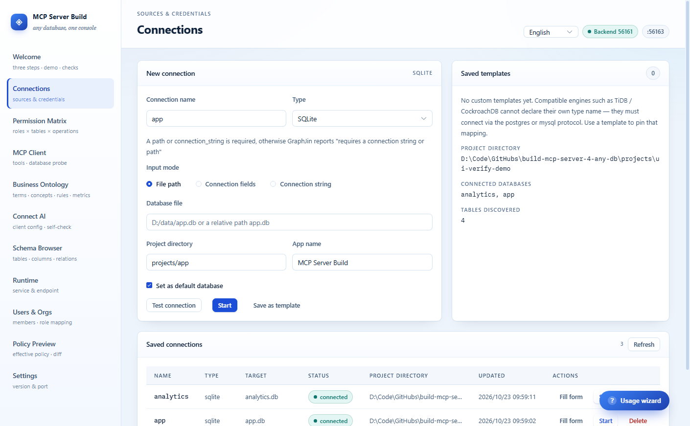
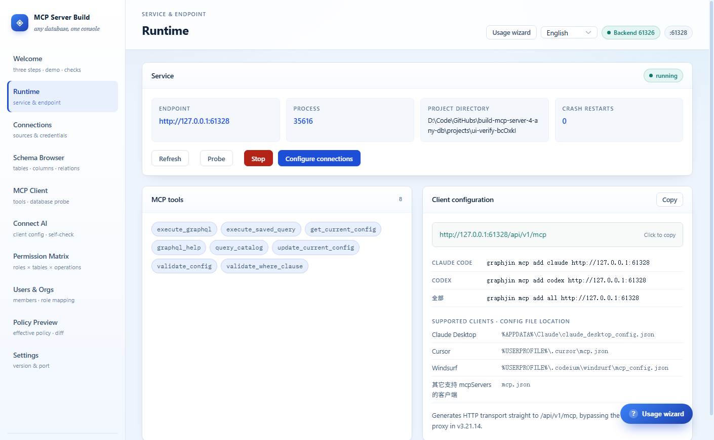
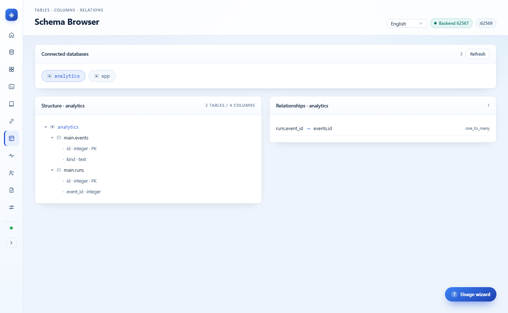
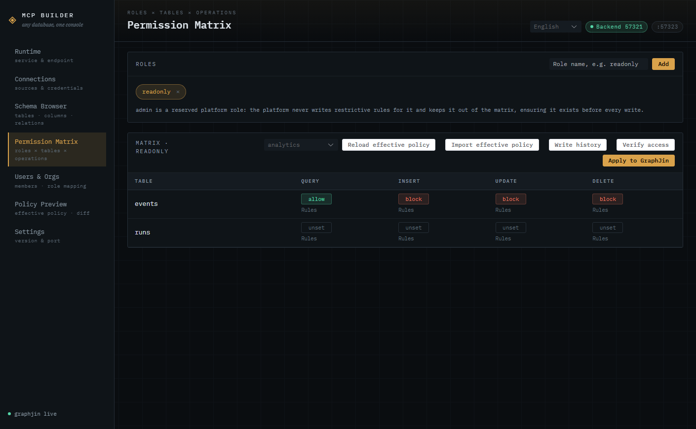
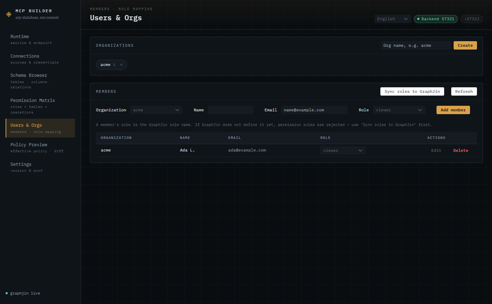
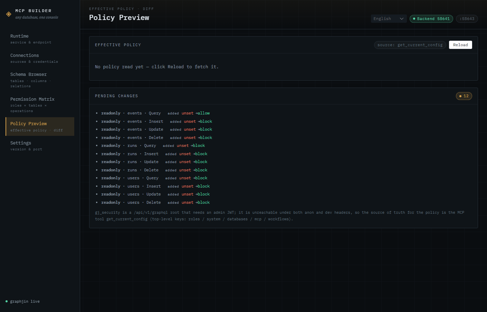

# MCP Server Build

**Configure GraphJin visually and turn any database into an MCP server.**

[中文](./README.md) · [Feature status](./docs/FEATURES.md)

MCP Server Build is a desktop tool: enter a database connection, and it starts GraphJin,
discovers the schema, and writes your permissions into GraphJin's `sources` config
(database-level read / write / delete modes plus per-role read grants). The result is an
HTTP endpoint (`/api/v1/mcp`) that Claude, Cursor and other MCP clients can connect to
directly — no hand-written YAML, no need to learn GraphJin's config format.

Legacy projects (`databases:` + `roles[].tables`) are migrated to `sources:` before the
service starts; the original file is kept as a `.bak` and restored automatically if the
migration fails.



## Contents

- [Architecture](#architecture)
- [Features](#features)
- [Requirements](#requirements)
- [Local startup](#local-startup)
- [Local test databases (Docker)](#local-test-databases-docker)
- [The GraphJin binary](#the-graphjin-binary)
- [Data and security](#data-and-security)
- [Verification](#verification)
- [Project layout](#project-layout)
- [Known limitations](#known-limitations)

## Architecture

```
┌───────────────────────────── Electron ─────────────────────────────┐
│  Vue 3 renderer (Pinia + Element Plus + vue-i18n)                  │
│         │ JSON-RPC over HTTP /rpc                                   │
│  Node backend (sidecar-backend)                                     │
│    ├── GraphJinSupervisor  process lifecycle, crash restarts        │
│    ├── McpClient           MCP Streamable HTTP client               │
│    ├── UserStore           users / orgs / connections (SQLite)      │
│    ├── permission planner  sources[].access + per-role grants       │
│    └── config migrator     legacy databases → sources (pre-start)   │
│         │ MCP tools                       │ child process           │
└─────────┼─────────────────────────────────┼─────────────────────────┘
          ▼                                 ▼
   GraphJin /api/v1/mcp              GraphJin (graphjin serve)
          │                                 │
          └─────────── business database (PostgreSQL / MySQL / SQLite …)┘
```

- **Why HTTP transport**: the bundled stdio proxy in v3.21.14 is broken (see the
  baseline doc), so the generated client config points straight at `/api/v1/mcp`.
- **The config model is source mode**: connections live in a `sources:` array, permissions
  in `sources[].access` (read / write / delete modes, owner column, table classes) and
  `access.grants` (per-role read rules). `databases:` and `roles[].tables` are the legacy
  shape — shipping them next to `sources:` makes the process die at startup, so the
  backend migrates old projects before starting GraphJin (see "Legacy migration").
- **Permission model**: the local role name *is* the GraphJin role name — no mapping
  layer. Writes take effect immediately.

## Features

### Runtime

Process state, endpoint, project directory, crash-restart count, health probe, stop,
and the copyable MCP client configuration.



### Connections

- Built-in drivers plus custom alias templates (TiDB / CockroachDB connect through the
  postgres / mysql protocol);
- Three input modes: file path, connection fields, connection string;
- **A connection is saved locally once a test or start succeeds**; the list below lets
  you refill the form, start from it, or delete it;
- Credentials are encrypted with the keystore key before hitting SQLite; the list only
  shows non-sensitive summary fields;
- Testing works even when the service is down: the backend spins up a throwaway
  GraphJin instance, validates, then stops it;
- Types flagged `driverVerified=false` (ClickHouse / Redshift / BigQuery …) have no
  working driver in the bundled GraphJin version, so Test and Start are disabled and the
  UI points you at the postgres / mysql protocol instead.

### Schema browser

The top bar lists the databases the running instance actually loaded. Picking one loads
its tables, columns and foreign keys only (`query_catalog` is filtered by
`database_name`, so multi-database projects never bleed into each other).



### Permission matrix

Two panels that mirror the two layers of GraphJin's source mode:

**Source access** (`sources[].access`, applies to the whole database):

- read / write / delete modes: read supports `public` / `authenticated` / `owner` /
  `account` / `blocked`, while write and delete offer `authenticated` / `owner` /
  `account` / `blocked`;
- the `owner` mode needs an owner column (row ownership filter; inserts filled with the
  current identity when the owner is omitted);
- two table classes: "admin only" (nobody but admin can read) and "blocked" (nobody,
  including admin, can read).

**Read matrix** (`sources[].access.grants[]`, role × table):

- the read toggle per role and table; tables not listed in any grant stay fully readable
  for authenticated roles, so blocking has to use the two table classes above;
- row filters (GraphJin DSL, `$user_code` and friends still work);
- column control: an allowlist, or a blocklist converted into its complement allowlist
  (GraphJin's `columns` only accepts an array and rejects an empty one).

Writes and deletes have no per-table switch and no write column allowlist — that is the
source-mode boundary, not an oversight (see "Known limitations").

On load everything is filled from the effective policy (empty cells only, local edits are kept);
**Import effective policy** overwrites uncommitted edits on purpose. Every write shows a
per-item diff and asks for confirmation.

The `×` on a role chip removes the local role. If the role is already in the effective
policy you get a confirmation explaining that GraphJin keeps its rules — reclaim them from
the write history.

**Verify access** runs one real GraphQL request as the selected role (`graphql.execute`).
GraphJin blocks queries silently (`null`, no errors) and mutations with `errors`; the panel
calls out both cases.

Every write also snapshots the current policy first (`policy_snapshots` in
`mcp-builder.db`, including `sources[].access`). Open **Write history** to inspect snapshots
and restore any of them; the state is snapshotted again before restoring, so a rollback can
itself be rolled back. `admin` is a reserved platform role: it is not part of the matrix,
the platform never writes restrictive rules for it, and a rollback never removes it.



### Legacy migration (databases → sources)

When the project's `dev.yml` is still in the legacy shape (`databases:` + `roles[].tables`),
**Start** migrates it first and then boots GraphJin with the new config:

1. start a throwaway instance and read roles and columns through the read-only config API
   (`get_current_config` / `query_catalog`);
2. move the `databases:` connections (the config API returns `[REDACTED]`, so real
   credentials come from the file) into `sources:`, folding `roles[].tables` filters and
   columns into `access.grants`;
3. stop the throwaway instance and let the supervisor restart with the new config.

The migration only reads config and rewrites the file — it never calls
`update_current_config`: every config write triggers a reload that reconnects all
databases, so a single unreachable database rejects the whole update (see
[`docs/graphjin-source-migration.md`](./docs/graphjin-source-migration.md) §2.4c, Chinese).

- the original file is backed up as `dev.yml.legacy-<timestamp>.bak` and restored
  automatically when the migration throws, with the real cause in the error;
- per-table write switches have no counterpart: write / delete degrade to the database
  level (default `blocked`) and the UI says so before writing;
- when databases are unreachable the catalog is empty, so no columns are known: the
  migration records a `missing-columns` conflict and **writes no grants** — under-granting
  beats silently allowing every column. Re-run the migration once the databases are back;
- the outcome (ok / reason / backup path) shows up in the `migration` field of the runtime
  status call.

### Users & orgs

Organizations and members live in local SQLite, so this page works even when GraphJin is
stopped:

- a member's role *is* the GraphJin role name; changing it writes straight back to SQLite;
- **Sync roles to GraphJin** adds the roles used by members to `roles` — grants that
  reference an unknown role are rejected (`role "x" is not defined in roles`);
- the role selector accepts new names (allow-create), so you need not create the role in
  the permission matrix first;
- MCP access tokens can be issued per member (12 hours by default); external clients then
  authenticate to the platform gateway with `Authorization: Bearer`;
- members can be edited (name / email); the `×` on an org chip deletes it, and the backend
  refuses while the org still has members.



### Policy preview

Reads the effective role policy from `get_current_config` and diffs it against the
pending matrix. The database selector at the top decides which database you compare, and
opening this page directly loads the schema for you.



### Settings

Backend port, bundled GraphJin version and cached platforms, copyable version info. The
UI switches between **中文 / English** (top right) and remembers the choice.


## Requirements

| Dependency | Version / notes |
|:--|:--|
| Node.js | **>= 22.5** (the backend uses `node:sqlite`) |
| npm | ships with Node |
| GraphJin binary | the `v3.21.14` tarballs are committed and extracted at build time; see step 3 of "Local startup" |
| Browser (optional) | `verify:ui` drives a local Edge / Chrome |
| Docker (optional) | only needed for the bundled test databases (Docker + compose v2) |

## Local startup

### 0. Complete startup commands (recommended)

From the project root (the directory containing `package.json`), run:

```bash
# Windows PowerShell example; use your real path on macOS / Linux
cd D:\Code\GitHubs\build-mcp-server-4-any-db

# 1. install dependencies (first time only)
npm install

# 2. prepare and verify the GraphJin binary (first time only; fetch first if the tarball is missing)
npm run prepare:binaries
npm run smoke:binaries

# 3. optional: create a demo SQLite database when you have none
npm run demo:db

# 4. one command: Vite + Electron + Node backend
npm start
```

`npm start` does four things:

1. starts the Vite dev server (`127.0.0.1:1420`);
2. waits for Vite, then starts Electron;
3. Electron starts the Node backend in-process and injects its dynamic port into the page;
4. on window close (Windows / Linux), `Cmd+Q` (macOS) or `Ctrl+C`, shuts down Electron,
   the backend and Vite together.

Process chain: `npm start` → Vite (1420) → Electron → Node backend; GraphJin is started by
the backend when you click **Start** in the UI.

Once the window is open, GraphJin still has to be started from the UI, because it needs the
database connection you enter:

1. open **Connections**, fill in the connection.
   - no database yet: run `npm run demo:db`, then choose **SQLite**, file path
     `projects/quickstart/demo.db`, project directory `projects/quickstart`;
   - existing database: SQLite points at a `.db` file; MySQL / PostgreSQL etc. need host,
     port, database, user and password;
   - **Project directory**: something like `projects/demo`;
2. click **Test connection**, then **Start**;
3. check **Schema browser**, then configure permissions in **Permission matrix**.

The equivalent **two-terminal** way (use either this or `npm start`):

```bash
# terminal 1
npm run dev

# terminal 2 (wait until terminal 1 prints Local)
npm run electron:dev
```

Use either way; `npm start` simply chains the two steps.

Startup-related commands:

| Command | Purpose |
|:--|:--|
| `npm start` | Vite + Electron + Node backend (recommended) |
| `npm run dev` | Vite only (`127.0.0.1:1420`) |
| `npm run electron:dev` | Electron + backend only; Vite must already be running |
| `npm run backend` | Node backend only (browser-only mode) |
| `npm run demo:db` | create a demo SQLite database |
| `npm run prepare:binaries` | extract GraphJin for the current platform |
| `npm run smoke:binaries` | execute GraphJin `version` as a smoke test |
| `npm run dist:win` / `dist:mac` / `dist:linux` | build the matching installer |

The sections below explain each step, browser-only mode and common problems.

### 1. Requirements

| Dependency | Requirement |
|:--|:--|
| Node.js | **>= 22.5**, 24.x recommended (the backend uses built-in `node:sqlite`) |
| npm | ships with Node |
| GraphJin binary | extracted from `graphjin-binaries/` at build time, see step 3 |
| Free port | Vite always uses `127.0.0.1:1420`; the backend and GraphJin pick free ports |
| Docker (optional) | only needed for the bundled test databases |

Check the version first:

```bash
node -v    # must be >= v22.5.0
npm -v
```

### 2. Install dependencies

From the repository root:

```bash
npm install
```

> Electron downloads a ~100 MB runtime on first install. If that is slow or blocked by a
> proxy, set a mirror and retry:
>
> ```bash
> # Windows PowerShell
> $env:ELECTRON_MIRROR = "https://npmmirror.com/mirrors/electron/"
> npm install
> ```
>
> You can also point `HTTPS_PROXY` / `HTTP_PROXY` at a local proxy.

### 3. Prepare the GraphJin binary

If the repository already contains `graphjin-binaries/v3.21.14/*.tar.gz`, just extract the
binary for the current platform:

```bash
npm run prepare:binaries
```

If the tarball is missing, download it first and then extract:

```bash
# platform: windows-amd64 / windows-arm64 / linux-amd64 /
#           linux-arm64 / darwin-amd64 / darwin-arm64
# replace windows-amd64 with your own platform key
npm run fetch:binaries -- --only windows-amd64
npm run prepare:binaries
```

Verify that it really runs:

```bash
npm run smoke:binaries
# expected: PASS  windows-amd64  ...  GraphJin 3.21.14
```

The extracted file lands in `binaries/graphjin-<target-triple>[.exe]`.
Set `GRAPHJIN_BIN` to use a custom executable.

### 4. Start the desktop app (two terminals)

Use two terminals: **start Vite first, then Electron**. You can also run the single
`npm start` command from step 0 instead.

Terminal 1:

```bash
npm run dev
```

Wait until it prints `Local: http://127.0.0.1:1420`.

Terminal 2:

```bash
npm run electron:dev
```

Electron then:

1. starts the Node backend in-process on a dynamic port;
2. injects that port into the renderer through launch arguments;
3. opens the desktop window pointing at the Vite page.

The window appearing means startup succeeded. On Windows / Linux closing it stops
GraphJin and the backend before exiting; on macOS closing it only hides the window, use
`Cmd+Q` to quit. Development data lives under Electron's `userData/data` (on Windows this
is usually `%APPDATA%\mcp-builder\data`).

### 5. Browser-only debugging (optional)

If you do not want Electron, start the frontend and backend manually in two terminals:

Terminal 1:

```bash
npm run backend
```

It prints one ready JSON line; note the port:

```json
{"jsonrpc":"2.0","method":"ready","params":{"port":50123,"pid":12345}}
```

Terminal 2:

```bash
npm run dev
```

Open <http://127.0.0.1:1420>, go to **Settings**, enter the port from the ready line and
click **Save and connect**. The header shows "backend online" once connected.

In browser mode data lives in `sidecar-backend/data`. Keep the `npm run backend` process
running; the UI reports the backend as offline after it stops.

### 6. First-run flow

1. **Connections**: enter a name, type and connection details.
   - no database: run `npm run demo:db` first, then pick SQLite, file path
     `projects/quickstart/demo.db` and project directory `projects/quickstart`;
   - SQLite: choose **File path** and point at an existing `.db` file;
   - MySQL / PostgreSQL etc.: fill host, port, database, user, password;
   - **Project directory**: e.g. `projects/demo` (relative to the repository root in
     development; prefer an absolute path in the packaged app). GraphJin writes `dev.yml`
     there.
2. Click **Test connection**. A successful test saves the connection locally.
3. Click **Start**. The backend creates/merges `dev.yml` and starts GraphJin.
4. Open **Schema browser** and confirm tables, columns and relationships were discovered.
5. Open **Permission matrix**, configure source access first (read / write / delete modes,
   owner column, table classes), then add roles and their read rules (row filters, column
   control). **Apply to GraphJin** shows a diff first and snapshots the policy before
   writing.
6. Open **Runtime** to see the endpoint, probe health and copy the MCP client config.

> `admin` is a reserved platform role: it is not part of the matrix, the platform never
> writes restrictive rules for it, and a rollback never removes it.

### 7. Stopping

- Desktop app: on Windows / Linux closing the window stops GraphJin and quits; on macOS
  closing the window only hides it, use `Cmd+Q` to quit.
- Browser mode: click **Stop** on the Runtime page, then `Ctrl+C` the backend terminal.
- If a terminal was killed, check for a leftover `graphjin` process holding a port.

### 8. Troubleshooting

| Symptom | Fix |
|:--|:--|
| `npm run dev` fails with `EADDRINUSE` / port 1420 in use | kill the old Vite process, or find the PID with `netstat -ano \| findstr :1420` (Windows) and stop it |
| Electron window is blank | make sure terminal 1 printed `Local: ...` first; optionally set `MCP_BUILDER_DEV_URL=http://127.0.0.1:1420` |
| Header says the backend is offline | in browser mode the port is wrong or `npm run backend` is not running; `http://127.0.0.1:<port>/health` should return `{"ok":true,...}` |
| "GraphJin binary not found" | run `npm run prepare:binaries` and `npm run smoke:binaries`, or point `GRAPHJIN_BIN` at the executable |
| `electron:dev` fails with `Cannot read properties of undefined (reading 'isPackaged')` | `ELECTRON_RUN_AS_NODE=1` is set, so Electron runs as Node; unset it and retry |
| GraphJin exits immediately after start | check the logs on the Runtime page and the project's `dev.yml`; common causes are port conflicts, unreachable databases or missing connection fields |
| `node:sqlite` errors | Node is older than 22.5; upgrade Node and re-run `npm install` |
| Saving a password-protected connection fails | make sure `keystore.key` exists and is readable in the data directory; lost keys mean old connections must be re-entered |
| `fetch:binaries` fails | make sure `curl` exists and GitHub is reachable, or put the official tarball into `graphjin-binaries/<version>/` manually |

### 9. Local verification (optional)

```bash
npm test                 # frontend policy tests + backend unit tests
npm run smoke:binaries   # GraphJin binary smoke test
npm run build            # production web build
npm run verify:ui        # real backend + headless Edge (21 checks)
```

Full end-to-end verification (starts GraphJin for real, creates databases, writes
permissions and rolls back):

```bash
cd sidecar-backend
npm run verify:e2e         # 24 checks
npm run verify:migration   # 12 checks: legacy migration, including an unreachable database
```

### Build installers

```bash
npm run dist:win    # Windows NSIS
npm run dist:mac    # macOS dmg + zip (run on macOS)
npm run dist:linux  # Linux AppImage + deb (run on Linux)
```

All output lands in `release-final/`. The matrix in `.github/workflows/build.yml`
packages on Windows / macOS 13 / macOS 14 / Ubuntu; CI has no signing certificates, so
the artifacts are unsigned.

To sign, set electron-builder's standard environment variables on the matching platform:

```bash
# macOS: certificate + notarization
CSC_LINK=/path/to/dev-id.p12 CSC_KEY_PASSWORD=... \
APPLE_ID=... APPLE_APP_SPECIFIC_PASSWORD=... APPLE_TEAM_ID=... \
npm run dist:mac

# Windows: code-signing certificate
WIN_CSC_LINK=C:/path/to/cert.pfx WIN_CSC_KEY_PASSWORD=... npm run dist:win
```

### Local test databases (Docker)

The repo ships
[`docs/docker-compose-4-test-db-connection.yml`](./docs/docker-compose-4-test-db-connection.yml):
four free-tier databases in one command, for exercising the driver list on the
Connections page (Oracle is commented out — the image is big).

```bash
docker compose -f docs/docker-compose-4-test-db-connection.yml up -d
docker compose -f docs/docker-compose-4-test-db-connection.yml ps
docker compose -f docs/docker-compose-4-test-db-connection.yml down
```

| Database | Port | User | Default database |
|:--|:--|:--|:--|
| MySQL 8.0 | 3306 | root | testdb |
| PostgreSQL 16 | 5432 | test | testdb |
| MongoDB 7.0 | 27017 | test | — |
| SQL Server 2022 | 1433 | sa | — |
| Oracle 23 Free (commented) | 1521 | test | FREE |

Passwords are not duplicated here — take them from the `environment` block in the yml
(`MYSQL_ROOT_PASSWORD`, `POSTGRES_PASSWORD`, `MONGO_INITDB_ROOT_PASSWORD`, `SA_PASSWORD`,
`ORACLE_PASSWORD`). Pick the matching type on the Connections page, use host `127.0.0.1`
with the port / user / password from the yml, then click "Test connection". To change a
password, edit the yml and recreate the container. To use Oracle, uncomment the block
(`gvenzl/oracle-free:23.4-slim`) and give it at least ~4 GB of memory.

> These containers are local test fixtures only: credentials are plain text in the file,
> no volumes are mounted (`restart: no`), and data is dropped on stop. They also start
> empty — create tables before expecting anything in the Schema browser.

## The GraphJin binary

At build time the tarball in `graphjin-binaries/<version>/` is extracted and renamed to
`graphjin-<target-triple>` inside `binaries/` (packaged into
`resources/binaries/` via `extraResources`).

```bash
# download official release assets and verify sha256 (needs network and curl)
npm run fetch:binaries -- --only windows-amd64

# extract and rename the binary for the current platform
npm run prepare:binaries

# really execute graphjin version and check it (CI runs this on all three platforms)
npm run smoke:binaries
```

Version and checksums live in `graphjin-binaries/version.json`; measured GraphJin
behaviour is documented in
[`docs/graphjin-3.21.14-baseline.md`](./docs/graphjin-3.21.14-baseline.md) (Chinese).

## Data and security

| Item | Location |
|:--|:--|
| Data directory | `userData/data` when packaged; `sidecar-backend/data` for `npm run backend` |
| Users / saved connections / policy snapshots | `mcp-builder.db` inside it (override: `MCP_BUILDER_DB`) |
| Encryption key | `keystore.key` inside it (override dir: `MCP_BUILDER_DATA_DIR`) |
| Connection templates | `db-templates.json` inside it |
| GraphJin project | the "project directory" from the Connections page, e.g. `projects/app/dev.yml` |

- The connection `payload` is encrypted with AES-256-GCM (reusing GraphJin's keystore
  key); passwords and connection strings are never stored in clear text, and the list
  endpoint only returns host / port / dbname / user / path summaries.
- If `keystore.key` is lost, old records cannot be decrypted: the UI marks them
  "re-enter required" and still restores the non-sensitive fields.
- Policy snapshots store role read rules and source access modes as plain JSON (no database
  credentials);
  the 30 most recent snapshots per project are kept and can be restored from the
  permission matrix's **Write history** dialog.

## Verification

```bash
cd sidecar-backend
npm test                 # backend unit tests (175)

npm run verify:e2e         # real end-to-end: start → discover → write → rollback (24)
npm run verify:migration   # legacy migration: roles/columns, degrade, unreachable DB (12)

cd ..
npm run test:frontend    # frontend policy normalization / diff (8)
npm run smoke:binaries   # execute graphjin version for real
npm run build
npm run verify:ui        # real backend + headless Edge: locales, orgs/members, write/verify/rollback (21)
npm run verify:ui -- --shots=docs/screenshots   # regenerate both locale screenshot sets
```

`verify:ui` starts its own backend and creates two SQLite databases (`app` /
`analytics`); no manual setup required.

## Project layout

```
electron/              Electron main process, preload (injects the backend port)
src/                   Vue 3 renderer
  views/               six pages (lazy-loaded routes)
  locales/             zh-CN / en-US copy
  stores/app.js        Pinia: service state, schema, permission matrix, snapshots
sidecar-backend/       Node backend
  src/                 JSON-RPC, GraphJin client, permission planner, legacy migration,
                       snapshots, connections
  test/                node:test suites
  scripts/             real-machine verification scripts
scripts/               local startup, demo DB, binary prep / smoke, UI smoke test
.github/workflows/     four-platform packaging CI
docs/                  baseline notes, migration design, feature matrix, UI screenshots
binaries/              GraphJin binaries (extracted at build time)
```

## Known limitations

- Installer signing / notarization is not wired up: CI produces unsigned artifacts, and
  macOS needs a manual first-launch approval;
- source mode has no per-table write switch: write / delete are database-level, and
  `grants[].columns` only constrains reads — write column allowlists are not enforced
  (`docs/graphjin-source-migration.md` §2.2);
- roles have no table visibility: tables absent from grants stay fully readable for
  authenticated roles, so you have to use the "admin only" / "blocked" table classes;
- `gj_security` needs an admin JWT, so the source of truth for policy is the MCP tool
  `get_current_config`;
- `dev.yml` merging understands this project's output, flow maps, quoted keys and
  GraphJin's rewritten file, but is not a general YAML parser: anchors / aliases / merge
  keys inside `sources:` are rejected with an explicit error instead of silently
  corrupting the file;
- when databases are unreachable the migration cannot read columns and writes no grants
  (a `missing-columns` conflict); re-run the migration after the databases come back;
- non-Windows coverage is currently the CI binary `version` smoke; the full UI smoke
  script still requires Windows + Edge.

The full done / not-done matrix is in [docs/FEATURES.md](./docs/FEATURES.md) (Chinese).


# Common Errors
## GraphJin didn't start
Based on win11：Enter into build-mcp-server-4-any-db\binaries folder and run cmd.exe
``` bash
npm run prepare:binaries
graphjin-x86_64-pc-windows-msvc.exe serve
```