# MCP Server Build

**可视化配置 GraphJin，把任意数据库变成 MCP Server。**

中文 | [English](./README.md) · [使用向导](./docs/GUIDE.md) · [功能进度](./docs/FEATURES.md)

MCP Server Build 是一个桌面端工具：填好数据库连接，它会启动 GraphJin、发现表结构，并把
权限写成 GraphJin 的 `sources` 配置（数据源级读 / 写 / 删档位 + 角色读规则）。最终产出的
是一个可直接接入 Claude、Cursor 等 MCP 客户端的 HTTP 端点（`/api/v1/mcp`），不需要手写
YAML，也不需要理解 GraphJin 的配置细节。

旧项目（`databases:` + `roles[].tables`）在启动时自动迁移成 `sources:`，原文件留
`.bak` 备份，迁移失败自动回滚。

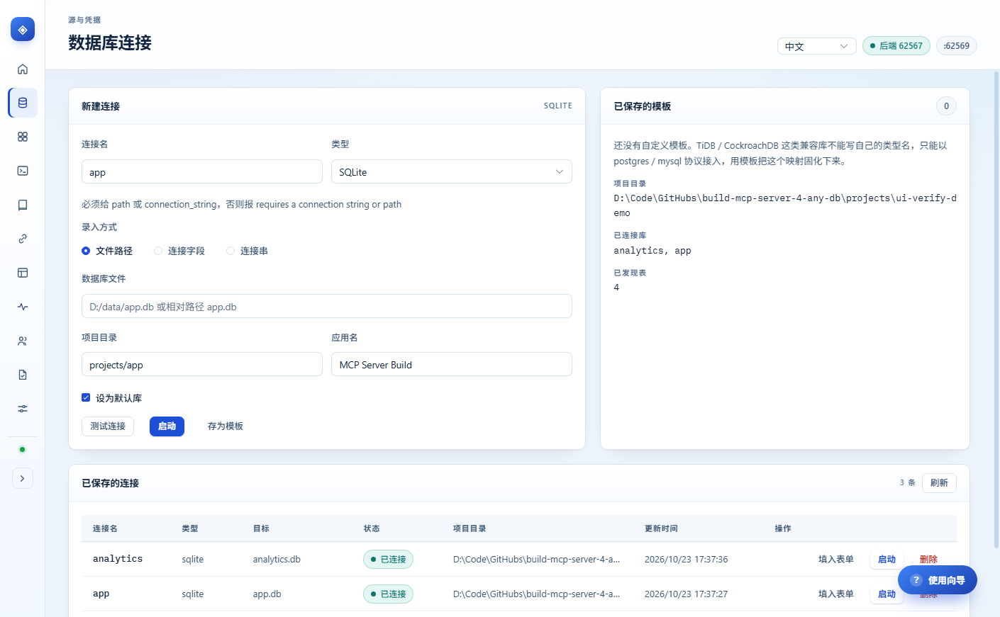

## 目录

- [使用向导](./docs/GUIDE.md) —— 从零到接入 AI 的完整走法
- [架构](#架构)
- [功能](#功能)
- [环境要求](#环境要求)
- [本地启动](#本地启动)
- [本地测试数据库（Docker）](#本地测试数据库docker)
- [GraphJin 二进制](#graphjin-二进制)
- [数据与安全](#数据与安全)
- [验证](#验证)
- [项目结构](#项目结构)
- [已知限制](#已知限制)
- [作者](#作者)

## 架构

```
┌───────────────────────────── Electron ─────────────────────────────┐
│  Vue 3 渲染进程（Pinia + Element Plus + vue-i18n）                  │
│         │ JSON-RPC over HTTP /rpc                                   │
│  Node 后端（sidecar-backend）                                        │
│    ├── GraphJinSupervisor  进程编排、崩溃重启                        │
│    ├── McpClient           MCP Streamable HTTP 客户端                │
│    ├── UserStore           用户 / 组织 / 连接记录（SQLite）           │
│    ├── 权限编排            sources[].access + 角色 grants             │
│    └── 配置迁移            legacy databases → sources（启动前）        │
│         │ MCP tools                       │ 子进程                    │
└─────────┼─────────────────────────────────┼─────────────────────────┘
          ▼                                 ▼
   GraphJin /api/v1/mcp              GraphJin（graphjin serve）
          │                                 │
          └─────────── 业务数据库（PostgreSQL / MySQL / SQLite …）──────┘
```

- **为什么走 MCP**：基线实测发现 v3.21.14 的内置 stdio proxy 有缺陷，因此客户端配置
  直接写 HTTP 传输，指向 `/api/v1/mcp`。
- **配置模型是 source 模式**：连接写在 `sources:` 数组里，权限写在 `sources[].access`
  （读 / 写 / 删档位、owner 列、表分类）与 `access.grants`（角色读规则）里。
  `databases:` 与 `roles[].tables` 是 legacy 形态，与 `sources:` 共存会让进程启动即
  FATAL，旧项目由后端在启动前迁移（见「旧项目迁移」）。
- **权限方案**：本地角色名即 GraphJin 角色名，不需要额外的映射表；写入后立刻生效。

## 功能

### 运行状态

查看 GraphJin 进程、端点、项目目录与崩溃重启次数，探活、停止、复制 MCP 客户端配置。

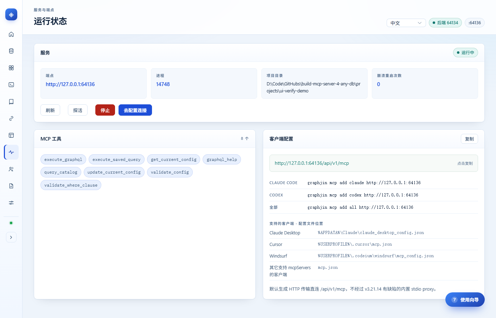

### 欢迎页与一键演示

打开应用先看到欢迎页：一句话讲清它做什么，下面按当前数据自动判定的三步状态（连接数据库 /
配置权限 / 接入 AI），点任意一步跳过去。想先看效果就点「一键体验演示」—— 10 秒建一个示例项目
（`orders` / `customers` 两张表 + `analyst` 只读角色，行过滤 `owner_code = 当前用户`，写删全部
blocked），**不碰你自己的库**；跑起来可以直接跳到 Schema 看表、跳到权限矩阵看规则。
底部还有「一键体检」：GraphJin 二进制、后端、运行实例、库连通、角色配置逐项打红绿灯。

首次进入会自动弹出**使用向导**（应用内分步指引：连接 → 配权限 → 验证 → 接入 AI，每步可直达
对应页面）；关闭后不再自动弹出，右下角悬浮「使用向导」按钮或顶栏按钮可随时再次打开。

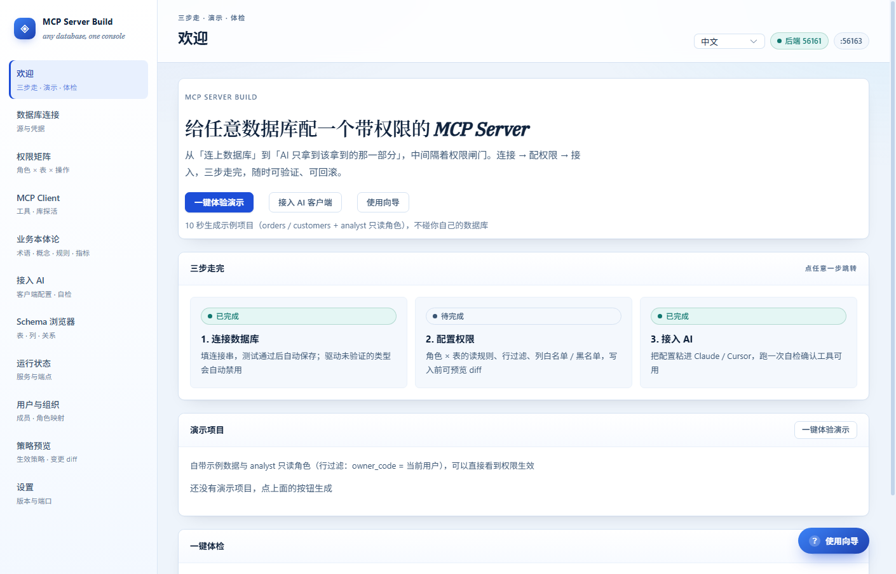

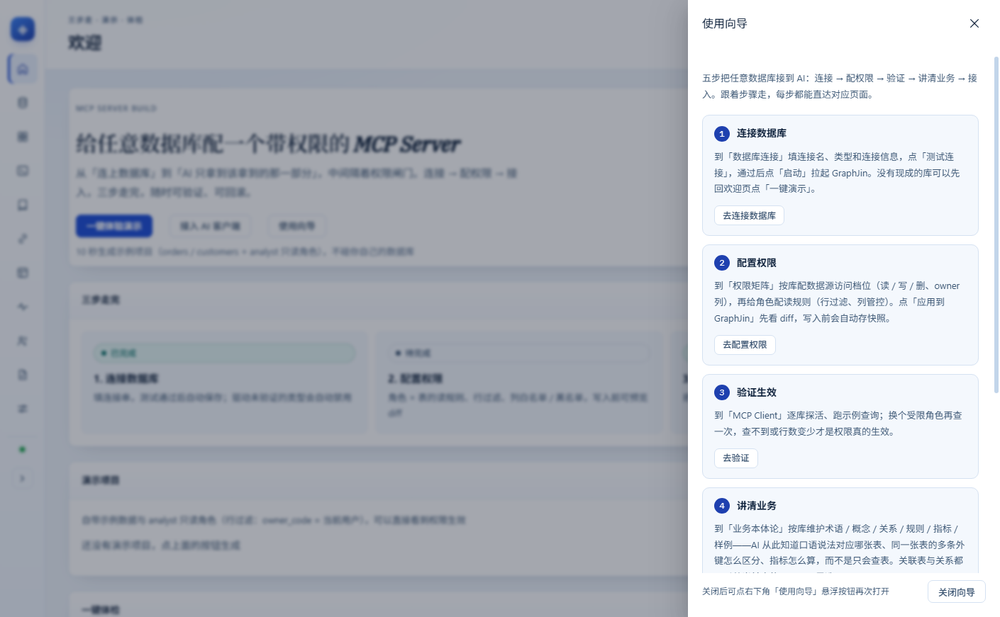

### 接入 AI 客户端

选 Claude Desktop / Claude Code / Cursor 等客户端，一键复制配置 JSON 或 `graphjin mcp add`
命令，最后跑一次自检调用 `tools/list`，确认端点通、工具真的暴露出来了。

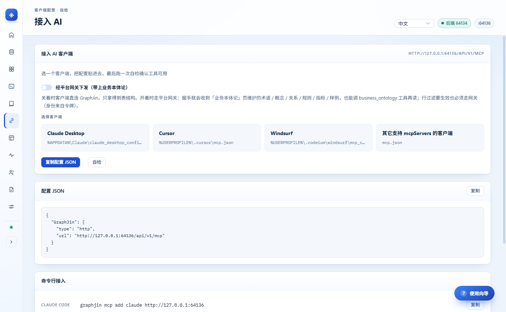

### 数据库连接

- 内置驱动 + 自定义别名模板（TiDB / CockroachDB 这类兼容库以 postgres / mysql 协议接入）；
- 三种录入方式：文件路径、连接字段、连接串；
- **测试通过或启动成功后自动保存到本地**，下方列表可回填表单、一键启动、删除；
- 状态列里的「已连接」由当前运行实例现算（项目目录 + dev.yml 里的库名都匹配才成立），
  停止服务或换项目后立刻回落成「已测试」，不会把上一次的启动结果留在状态列；
- 删除连接会同步把它从运行实例的 `dev.yml` 里摘掉：还有别的库就重启实例，删的是最后一个库
  则停掉服务，Schema 浏览器与权限矩阵不会再显示这个库；
- 连接凭据用 keystore key 加密后写入 SQLite，列表只显示非敏感摘要；
- 未启动服务也能测试连接：后端会临时拉起一个用完即停的 GraphJin 实例；
- 白名单里 `driverVerified=false` 的类型（ClickHouse / Redshift / BigQuery 等）在当前
  GraphJin 版本连接层未实现，测试与启动按钮会直接禁用，并提示改用 postgres / mysql 协议。


### Schema 浏览器

顶部列出运行中实例实际加载的数据库，切换后按库加载表、列与外键关系（`query_catalog`
带 `database_name` 过滤，多库数据不会串）。

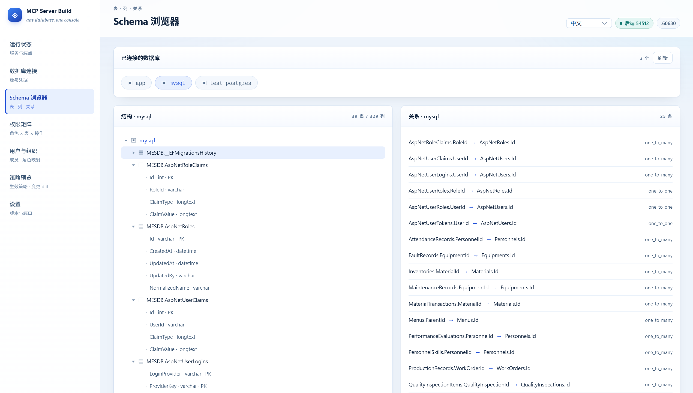

### MCP Client

内置 MCP 客户端直连运行中的实例（`initialize` → `tools/list` → `tools/call`），用来验证
`dev.yml` 里配置的每个库是否真的可用：「测试全部库」对每个 source 读一次 catalog，再用该库
独有的第一张表跑一次最小查询，逐库给出状态、表数、取样表与耗时，任一库失败标红。同一页面
还能按角色列出工具，并手写 GraphQL 走 `execute_graphql` 执行、看原始返回。查询框下方给
出按当前库真实表名生成的示例查询，点一下填入；「调用示例」列出 `execute_graphql` 等工具的
参数 JSON，可一键复制后直接贴给 AI 客户端。

跨库重名的表没法用纯表名定位到具体库（实测会落到默认库），这类库只做 catalog 校验并标注
「仅 catalog」，不会误报通过。

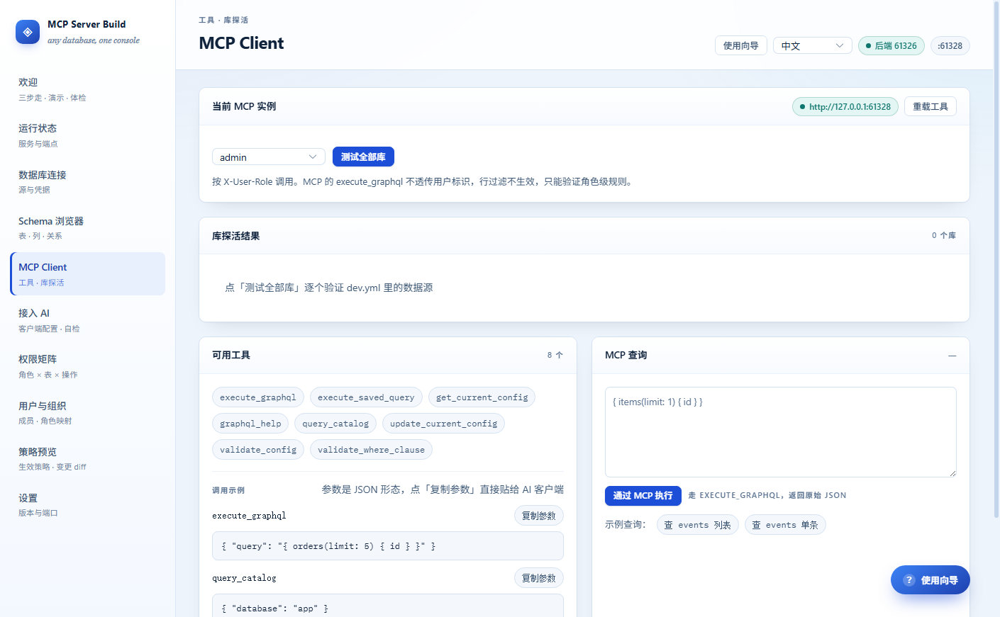

> MCP 的 `execute_graphql` 不透传用户标识，行过滤不生效 —— 这里只验证角色级规则；
> 行级权限请用「权限矩阵」页的验证面板（走 HTTP GraphQL）。

### 权限矩阵

顶部按数据源分成标签页：**每个库一套独立的角色清单、矩阵和未提交改动**，切换标签不会串数据；标签上的小圆点表示该库有未提交改动。写入只作用于当前标签的库，确认弹窗会写明目标库名。

每个标签内部又分成两块，对应 GraphJin source 模式的两层结构：

**数据源访问**（`sources[].access`，对整个库生效）：

- 读 / 写 / 删三档：读档位可选 `public` / `authenticated` / `owner` / `account` / `blocked`，
  写与删只有 `authenticated` / `owner` / `account` / `blocked`；
- `owner` 档位需要填 owner 列（行归属过滤，insert 时未填归属会自动补当前身份）；
- 「仅管理员可读」与「全局屏蔽」两组表：前者只有 admin 能读，后者对所有人（含 admin）不可读。

**读规则矩阵**（`sources[].access.grants[]`，角色 × 表）：

- 角色 × 表的读开关；未列入任何规则的表对已认证角色完全可读，所以「拦」要用上面两组表；
- 行过滤条件（GraphJin DSL，可用 `$user_code` 等身份变量）；
- 列管控：白名单，或「阻止列表」自动转成补集白名单（GraphJin 的 `columns` 只接受数组、
  且必填，空数组会被拒）。

写与删没有表级开关，也没有写列白名单——这是 source 模式的边界，不是遗漏（见「已知限制」）。

启动后自动用生效策略回填（只补空格子，不覆盖本地改动）；也可以点「从生效策略导入」
用生效策略覆盖本地未提交的改动。写入前展示逐项 diff 并二次确认。

角色标签上的 `×` 可移除本地角色；角色已写进生效策略时会先确认，并说明 GraphJin 里的
规则要回收得走「写入历史」回滚。

「验证权限」按所选角色真跑一条 GraphQL（`graphql.execute`）：query 被拦时 GraphJin 是
静默的（返回 `null`、不报错），写操作被拦才返回 `errors`，面板会把这两种情况分开提示。

每次写入前会自动保存一份策略快照（`mcp-builder.db` 的 `policy_snapshots` 表，含
`sources[].access`），点「写入历史」可查看并按时间恢复；回滚前会再存一份，所以回滚本身
也能撤销。`admin` 是平台保留角色，不进入矩阵，平台也不会为它写限制规则；它不会被回滚删除。

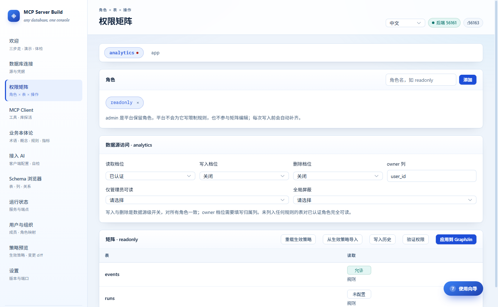

### 旧项目迁移（databases → sources）

检测到项目目录下的 `dev.yml` 还是 legacy 形态（`databases:` + `roles[].tables`）时，
「启动」会先自动迁移再按新配置启动：

1. 起一个临时实例，用只读的配置 API（`get_current_config` / `query_catalog`）读回角色与列清单；
2. 把 `databases:` 的连接信息（配置 API 返回 `[REDACTED]`，真实凭据从文件读）搬进
   `sources:`，`roles[].tables` 的 filter / columns 折算成 `access.grants`；
3. 停掉临时实例，由 supervisor 按新配置重启。

迁移全程只读配置、直接改写文件，不走 `update_current_config`：该接口每次写入都会 reload
并重连所有库，只要有一个库连不上，整次更新就被拒（详见
[`docs/graphjin-source-migration.md`](./docs/graphjin-source-migration.md) §2.4c）。

- 原文件备份为 `dev.yml.legacy-<时间戳>.bak`，迁移抛错会自动还原并报出明确原因；
- 表级写开关没有对应结构，写 / 删降级为数据源级（默认 `blocked`），并在写入前提示；
- 库连不上时 catalog 为空、拿不到列清单，会记 `missing-columns` 冲突且**不生成** grants
  ——宁可少授权，也不会退化成全列可读；库恢复后重跑一次迁移即可补齐；
- 迁移结果（成功 / 失败原因 / 备份路径）出现在运行状态接口的 `migration` 字段里。

### 用户与组织

本地维护组织与成员（SQLite，不依赖 GraphJin 是否在跑）：

- 成员角色直接就是 GraphJin 角色名，改角色即时写回本地库；
- 「同步角色到 GraphJin」把成员用到的角色补进 `roles` —— grants 引用不存在的角色会被拒
  （`role "x" is not defined in roles`）；
- 角色下拉支持直接输入新角色名（allow-create），不用先去权限矩阵建角色；
- 可为成员签发 MCP 访问令牌（默认 12 小时），外部客户端用 `Authorization: Bearer` 连平台网关；
- 成员可改姓名 / 邮箱；组织标签上的 `×` 可删除组织，组织下还有成员时后端会拒绝删除。

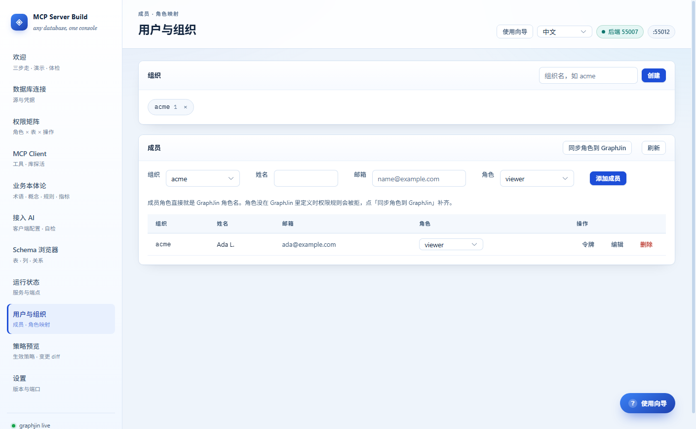

### 策略预览

从 `get_current_config` 读取当前生效的角色策略，和待写入的矩阵做 diff。顶部库选择决定
看哪个库；直接打开本页会自动加载 Schema，不依赖先逛一遍权限矩阵。

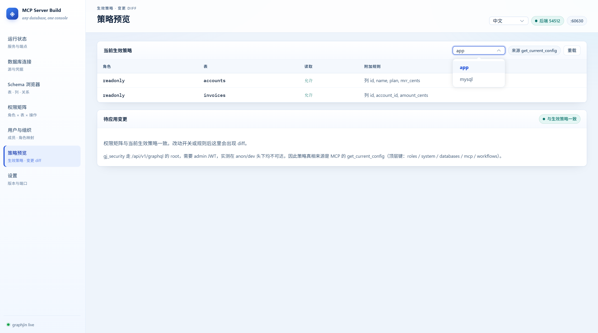

### 设置

后端端口、内置 GraphJin 版本与缓存平台、版本信息复制。界面支持 **中文 / English**
切换（右上角），选择会持久化到本地。

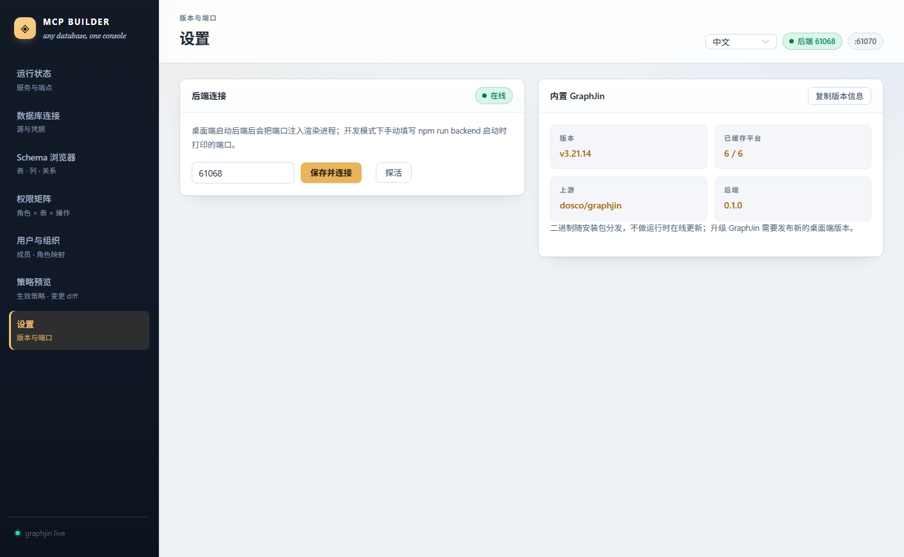

英文界面：

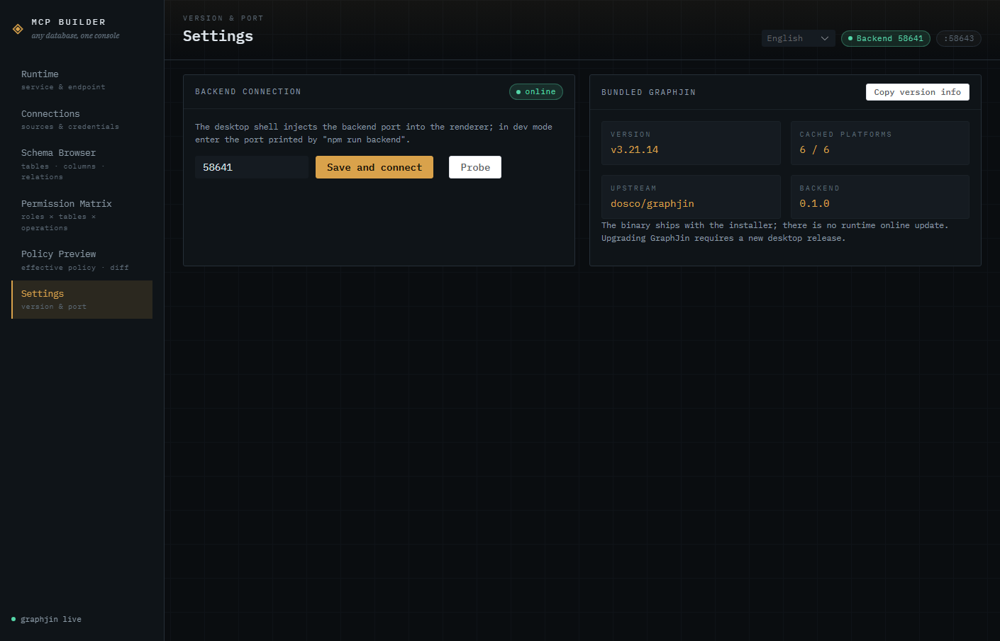

## 环境要求

| 依赖 | 版本 / 说明 |
|:--|:--|
| Node.js | **>= 22.5**（后端使用 `node:sqlite`） |
| npm | 随 Node 分发 |
| GraphJin 二进制 | 仓库内带 `v3.21.14` 压缩包，构建期解压；见「本地启动」第 3 步 |
| 浏览器（可选） | `verify:ui` 需要本机 Edge / Chrome |
| Docker（可选） | 只想连 SQLite 或已有数据库可不装；跑本地测试库需要 Docker + compose v2 |

## 本地启动

### 0. 完整启动命令（推荐）

先进入 `package.json` 所在的项目根目录，然后按顺序执行：

```bash
# Windows PowerShell 示例；macOS / Linux 换成实际路径
cd D:\Code\GitHubs\build-mcp-server-4-any-db

# 1. 安装依赖（只需第一次）
npm install

# 2. 准备并验证 GraphJin 二进制（只需第一次；缺压缩包时先 fetch）
npm run prepare:binaries
npm run smoke:binaries

# 3. 可选：手头没有数据库时，创建一个演示 SQLite 库
npm run demo:db

# 4. 一键启动：Vite + Electron + Node 后端
npm start
```

`npm start` 实际做了四件事：

1. 启动 Vite 开发服务器（`127.0.0.1:1420`）；
2. 等 Vite 就绪后启动 Electron；
3. Electron 主进程在进程内启动 Node 后端，并把动态端口注入页面；
4. 关闭窗口（Windows / Linux）、按 `Cmd+Q`（macOS）或 `Ctrl+C` 时，把 Electron、
   Node 后端和 Vite 一起清理。

进程关系：`npm start` → Vite（1420）→ Electron → Node 后端；GraphJin 在界面点「启动」后
由后端拉起。

启动成功后，还需要在界面里启动 GraphJin。GraphJin 是**按你填写的数据库连接**启动的，
不能由命令行预先写死：

1. 打开「数据库连接」，填连接信息。
   - 没有现成数据库时，先跑 `npm run demo:db`，然后选类型 **SQLite**、
     文件路径 `projects/quickstart/demo.db`、项目目录 `projects/quickstart`；
   - 已有数据库：SQLite 直接填 `.db` 文件，MySQL / PostgreSQL 等填主机、端口、库名、用户、密码；
   - 「项目目录」填 `projects/demo` 这类目录；
2. 点「测试连接」，再点「启动」；
3. 到「Schema 浏览器」确认表结构，到「权限矩阵」配置权限。

### 订单演示数据（含多用户隔离）

```bash
npm run demo:orders                     # 写入开发数据目录 sidecar-backend/data
npm run demo:orders -- --db <路径>      # 指定 Electron 用的 mcp-builder.db
```

脚本会建 `projects/demo-orders/demo.db`、组织 `demo-shop`、两个用户，并写入权限矩阵，
最后用真实查询跑 9 项断言（失败会以非零码退出）：

| 用户 | 角色 | 行过滤 | 列 | 写操作 |
|:--|:--|:--|:--|:--|
| `user-a@demo.local` | `customer` | `owner_code = $user_code` | 白名单 6 列，看不到 `internal_note` | 全阻止 |
| `user-b@demo.local` | `ops` | 无（看全部） | 不限 | 允许更新、删除 |

**多用户身份走「平台网关 + JWT」**：外部客户端只认平台签发的令牌，网关验签后把身份降级成
回环连接上的 `X-User-Role` / `X-User-Code`，不让 GraphJin 直接验 JWT——这样外部客户端拿不到
能冒充 admin 的身份头（GraphJin 仍以 `auth.type: none` 只监听回环）。链路是：

```
外部客户端 → http://127.0.0.1:<后端端口>/api/v1/mcp
             Authorization: Bearer <JWT>
           → 平台网关验签
           → 注入 X-User-Role / X-User-Code（仅回环）
           → GraphJin（只监听 127.0.0.1，auth.type: none）
```

令牌用 `auth.token` RPC 按用户签发（默认 12 小时），客户端配置由 `mcp.clientConfig`
带 `gatewayUrl` + `token` 生成。

> **已知限制**：MCP 的 `execute_graphql` 不透传自定义请求头，`$user_code` 因此解析为空，
> 行过滤会退化成 0 行。所以**行级隔离只在平台内的 HTTP GraphQL 路径生效**
>（验证面板、`graphql.execute`）；外部 MCP 客户端能用角色与列白名单，但拿不到按人过滤的行。
> 彻底解决需要在网关里把 `execute_graphql` 改写成 GraphQL 请求，尚未实现。

如果不想用一键脚本，等价的**手动分终端**方式是：

```bash
# 终端 1
npm run dev

# 终端 2（等终端 1 打印 Local 后再执行）
npm run electron:dev
```

两种方式只需要选一种；`npm start` 只是把这两步串起来。

启动相关命令一览：

| 命令 | 作用 |
|:--|:--|
| `npm start` | Vite + Electron + Node 后端（推荐） |
| `npm run dev` | 只启动 Vite（`127.0.0.1:1420`） |
| `npm run electron:dev` | 只启动 Electron + 后端；要求 Vite 已在运行 |
| `npm run backend` | 只启动 Node 后端（供纯浏览器模式使用） |
| `npm run demo:db` | 创建演示 SQLite 库 |
| `npm run prepare:binaries` | 解压当前平台的 GraphJin |
| `npm run smoke:binaries` | 真实执行 GraphJin `version` 做冒烟 |
| `npm run dist:win` / `dist:mac` / `dist:linux` | 打包对应平台安装包 |

下面是每一步的详细说明、纯浏览器模式和常见问题。

### 1. 准备环境

| 依赖 | 要求 |
|:--|:--|
| Node.js | **>= 22.5**，推荐 24.x（后端使用内置 `node:sqlite`） |
| npm | 随 Node 分发 |
| GraphJin 二进制 | 构建期从 `graphjin-binaries/` 解压，见第 3 步 |
| 可用端口 | Vite 固定使用 `127.0.0.1:1420`；后端与 GraphJin 端口动态分配 |
| Docker（可选） | 只有跑本地测试数据库时需要 |

先确认版本：

```bash
node -v    # 应 >= v22.5.0
npm -v
```

### 2. 安装依赖

在项目根目录执行：

```bash
npm install
```

> Electron 首次安装会下载约 100 MB 的运行时。如果下载慢或被代理拦截，可以设置镜像后重试：
>
> ```bash
> # Windows PowerShell
> $env:ELECTRON_MIRROR = "https://npmmirror.com/mirrors/electron/"
> npm install
> ```
>
> 也可以设置 `HTTPS_PROXY` / `HTTP_PROXY` 走本地代理。

### 3. 准备 GraphJin 二进制

仓库内已带 `graphjin-binaries/v3.21.14/*.tar.gz` 时，直接解压当前平台的二进制：

```bash
npm run prepare:binaries
```

如果缺少压缩包，先下载当前平台的发布包，再解压：

```bash
# 平台可选：windows-amd64 / windows-arm64 / linux-amd64 /
#           linux-arm64 / darwin-amd64 / darwin-arm64
# 其他平台把 windows-amd64 换成自己的 key
npm run fetch:binaries -- --only windows-amd64
npm run prepare:binaries
```

验证二进制能真实启动：

```bash
npm run smoke:binaries
# 期望输出：PASS  windows-amd64  ...  GraphJin 3.21.14
```

解压后的文件位于 `binaries/graphjin-<target-triple>[.exe]`。
如需使用自定义路径，可设置环境变量 `GRAPHJIN_BIN`。

### 4. 启动桌面端（手动分终端）

需要两个终端，**先起 Vite，再起 Electron**。也可以直接用第 0 步的 `npm start`
一次拉起两者。

终端 1：

```bash
npm run dev
```

等到出现 `Local: http://127.0.0.1:1420` 后再继续。

终端 2：

```bash
npm run electron:dev
```

Electron 会：

1. 在进程内启动 Node 后端（动态端口）；
2. 把后端端口通过启动参数注入渲染进程；
3. 打开桌面窗口并加载 Vite 页面。

看到窗口即启动成功。Windows / Linux 关闭窗口会先停止 GraphJin 和后端再退出；
macOS 关闭窗口只隐藏窗口，退出请用 `Cmd+Q`。开发态数据落在 Electron 的
`userData/data`（Windows 通常是 `%APPDATA%\mcp-builder\data`）。

窗口标题会显示当前项目名（启动参数里的应用名，落在项目 `dev.yml` 的 `app_name`），
形如 `Demo Orders — MCP Server Build`；Windows 用的是自绘标题栏，项目名居中画在那条
40px 标题带上，没打开项目时回落到产品名。

### 5. 纯浏览器调试（可选）

不想开 Electron 时，可以用两个终端手动起前后端：

终端 1：

```bash
npm run backend
```

它会打印一行 ready JSON，记下其中的端口：

```json
{"jsonrpc":"2.0","method":"ready","params":{"port":50123,"pid":12345}}
```

终端 2：

```bash
npm run dev
```

浏览器打开 <http://127.0.0.1:1420>，进入「设置」页，填入上一步的 `port`，
点「保存并连接」。右上角出现「后端在线」即接通。

纯浏览器模式的数据目录是 `sidecar-backend/data`。`npm run backend` 的进程必须
保持运行；停止后前端会显示后端离线。

### 6. 首次配置流程

1. **数据库连接页**：填写连接名、类型和连接信息。
   - 没有数据库时先执行 `npm run demo:db`，然后选 SQLite、文件路径
     `projects/quickstart/demo.db`、项目目录 `projects/quickstart`；
   - SQLite：录入方式选「文件路径」，填已有的 `.db` 文件；
   - MySQL / PostgreSQL 等：填主机、端口、库名、用户、密码；
   - 「项目目录」填 `projects/demo` 之类的目录（开发时相对仓库根目录，
     打包后建议填绝对路径），GraphJin 的 `dev.yml` 会写在这里。
2. 点「测试连接」。测试通过后连接会自动保存到本地列表。
3. 点「启动」。后端会创建/合并 `dev.yml` 并拉起 GraphJin。
4. 到 **Schema 浏览器** 确认表、列和关系已经发现。
5. 到 **权限矩阵** 先配数据源访问（读 / 写 / 删档位、owner 列、表分类），再添加角色配读规则
   （行过滤、列管控）；点「应用到 GraphJin」后按 diff 确认，写入前会自动保存快照。
6. 到 **运行状态** 页查看端点、探活、复制 MCP 客户端配置。

> `admin` 是平台保留角色：不进入矩阵，平台不会为它写限制规则，也不会在回滚时删除它。

### 7. 停止

- 桌面端：Windows / Linux 关闭窗口即可，主进程会先停 GraphJin 再退出；
  macOS 关闭窗口只隐藏窗口，请用 `Cmd+Q` 退出应用。
- 浏览器模式：先在「运行状态」点「停止」，再在终端 `Ctrl+C` 结束后端。
- 如果终端被强制关闭，检查是否还有 `graphjin` 进程占用端口。

### 8. 常见问题

| 现象 | 处理 |
|:--|:--|
| `npm run dev` 报 `EADDRINUSE` / 1420 被占用 | 关掉旧的 Vite 进程，或用 `netstat -ano \| findstr :1420`（Windows）找到 PID 后结束 |
| Electron 窗口空白 | 确认终端 1 的 Vite 已经打印 `Local: ...`；必要时设置 `MCP_BUILDER_DEV_URL=http://127.0.0.1:1420` 再启动 |
| 右上角显示后端离线 | 浏览器模式下端口填错或 `npm run backend` 没在运行；访问 `http://127.0.0.1:<port>/health` 应返回 `{"ok":true,...}` |
| 提示找不到 GraphJin 二进制 | 执行 `npm run prepare:binaries` 和 `npm run smoke:binaries`，或设置 `GRAPHJIN_BIN` 指向可执行文件 |
| `electron:dev` 报 `Cannot read properties of undefined (reading 'isPackaged')` | 环境里设置了 `ELECTRON_RUN_AS_NODE=1`，Electron 被当成 Node 运行；取消该变量后重试 |
| GraphJin 启动后立刻退出 | 查看「运行状态」里的日志和项目目录下 `dev.yml`；常见原因是端口冲突、数据库连不上或连接字段缺失 |
| `node:sqlite` 相关报错 | Node 版本低于 22.5，升级 Node 后重新 `npm install` |
| 带密码的连接保存失败 | 确认数据目录下的 `keystore.key` 存在且可读；丢失后旧连接需要重新录入密码 |
| `fetch:binaries` 失败 | 确认本机有 `curl` 且能访问 GitHub；也可以手动把官方压缩包放进 `graphjin-binaries/<version>/` |

### 9. 本地验证（可选）

```bash
npm test                 # 前端策略单测 + 后端单测
npm run smoke:binaries   # GraphJin 二进制冒烟
npm run build            # 前端生产构建
npm run verify:ui        # 真实后端 + Edge headless（42 项）
```

完整的端到端验证（会真实拉起 GraphJin、建库、写权限并回滚）：

```bash
cd sidecar-backend
npm run verify:e2e         # 24 项
npm run verify:migration   # 12 项：legacy 项目迁移，含一个数据库不可达的项目
```

### 构建安装包

```bash
npm run dist:win    # Windows NSIS
npm run dist:mac    # macOS dmg + zip（需在 macOS 上执行）
npm run dist:linux  # Linux AppImage + deb（需在 Linux 上执行）
```

产物都在 `release-final/`。三个 `dist:*` 脚本会先跑 `npm run check:binaries`，确认当前平台的
`binaries/graphjin-<triple>` 已就位（缺失时提示先跑 `fetch:binaries` + `prepare:binaries`），
避免打出不含 GraphJin 的空壳安装包。跨平台打包由 `.github/workflows/build.yml` 的矩阵在
Windows / macOS 13 / macOS 14 / Ubuntu 上完成；CI 没有签名证书，产物未签名。

需要签名时在对应平台设置 electron-builder 的标准环境变量后再执行构建：

```bash
# macOS：证书 + 公证
CSC_LINK=/path/to/dev-id.p12 CSC_KEY_PASSWORD=... \
APPLE_ID=... APPLE_APP_SPECIFIC_PASSWORD=... APPLE_TEAM_ID=... \
npm run dist:mac

# Windows：代码签名证书
WIN_CSC_LINK=C:/path/to/cert.pfx WIN_CSC_KEY_PASSWORD=... npm run dist:win
```

### 本地测试数据库（Docker）

仓库自带 [`docs/docker-compose-4-test-db-connection.yml`](./docs/docker-compose-4-test-db-connection.yml)，
一键拉起四种免费版数据库，用来验证「数据库连接」页的各类驱动（Oracle 默认注释掉，镜像偏大）。

```bash
docker compose -f docs/docker-compose-4-test-db-connection.yml up -d
docker compose -f docs/docker-compose-4-test-db-connection.yml ps
docker compose -f docs/docker-compose-4-test-db-connection.yml down
```

| 数据库 | 端口 | 用户 | 默认库 |
|:--|:--|:--|:--|
| MySQL 8.0 | 3306 | root | testdb |
| PostgreSQL 16 | 5432 | test | testdb |
| MongoDB 7.0 | 27017 | test | — |
| SQL Server 2022 | 1433 | sa | — |
| Oracle 23 Free（默认注释） | 1521 | test | FREE |

密码不在这里复制，统一以 yml 里 `environment` 的取值为准（`MYSQL_ROOT_PASSWORD`、
`POSTGRES_PASSWORD`、`MONGO_INITDB_ROOT_PASSWORD`、`SA_PASSWORD`、`ORACLE_PASSWORD`）。
连接页选对应类型，主机填 `127.0.0.1`，端口 / 用户 / 密码与 yml 保持一致，点「测试连接」即可；
要换密码直接改 yml 后重启容器。
要用 Oracle 就打开 yml 里的注释块（`gvenzl/oracle-free:23.4-slim`），内存建议留 4 GB 以上。

> 这组容器只用于本地测试：凭据明文写在文件里、不挂数据卷（`restart: no`），
> 停止后数据即丢弃。刚起来的库是空的，Schema 浏览器要先建表才有内容。

## GraphJin 二进制

构建期从 `graphjin-binaries/<version>/*.tar.gz` 解压，按 `graphjin-<target-triple>` 命名
放进 `binaries/`（打包时随 `extraResources` 落到 `resources/binaries/`）。

```bash
# 下载官方发布包并校验 sha256（需要网络与 curl）
npm run fetch:binaries -- --only windows-amd64

# 解压并重命名当前平台的二进制
npm run prepare:binaries

# 真实执行 graphjin version，核对版本号（CI 三平台各跑一次）
npm run smoke:binaries
```

版本与校验信息见 `graphjin-binaries/version.json`，GraphJin 的实测行为记录在
[`docs/graphjin-3.21.14-baseline.md`](./docs/graphjin-3.21.14-baseline.md)。

## 数据与安全

| 内容 | 位置 |
|:--|:--|
| 数据目录 | 打包后 `userData/data`；`npm run backend` 时是 `sidecar-backend/data` |
| 用户库 / 连接记录 / 策略快照 | 数据目录下 `mcp-builder.db`（可用 `MCP_BUILDER_DB` 覆盖） |
| 加密密钥 | 数据目录下 `keystore.key`（可用 `MCP_BUILDER_DATA_DIR` 改目录） |
| 连接模板 | 数据目录下 `db-templates.json` |
| GraphJin 项目 | 连接页里填写的「项目目录」，例如 `projects/app/dev.yml` |

- 连接记录里的 `payload` 整段用 AES-256-GCM 加密（密钥复用 GraphJin keystore key），
  密码与连接串不落明文；列表只返回 host / port / dbname / user / path 等摘要。
- `keystore.key` 丢失后旧记录无法解密，界面会标记「需重新录入」，可回填非敏感字段后重测。
- 策略快照明文保存角色读规则与数据源访问档位（不含数据库凭据），每个项目保留最近 30 份；
  写入前自动保存，可在权限矩阵的「写入历史」里回滚。

## 验证

```bash
cd sidecar-backend
npm test                 # 后端单测（191 项）

npm run verify:e2e         # 真机全链路：启动 → 发现 → 权限写入 → 快照回滚（24 项）
npm run verify:migration   # legacy 项目迁移：角色/列折算、写删降级、库不可达（12 项）

cd ..
npm run test:frontend    # 前端策略归一化 / diff（8 项）
npm run smoke:binaries   # GraphJin 二进制真实执行 version
npm run build
npm run verify:ui        # 真实后端 + Edge headless：中英文切换、窗口标题、建组织/成员、权限写入/验证/回滚、每库独立标签、MCP 逐库探活与调用示例、右下角悬浮按钮存在/可打开、使用向导自动弹出/关闭/再开/跳转、停止后状态回落、删库后 Schema 重置、欢迎页/接入向导/一键演示/一键体检（42 项）
npm run verify:ui -- --shots=docs/screenshots   # 逐页产出中英文截图
```

`verify:ui` 会自己起后端、建两个 SQLite 库（`app` / `analytics`），不依赖手工准备环境。

## 项目结构

```
electron/              Electron 主进程、preload（注入后端端口）
src/                   Vue 3 前端
  views/               10 个页面（路由懒加载）
  locales/             zh-CN / en-US 文案
  stores/app.js        Pinia：服务状态、Schema、权限矩阵、写入快照
sidecar-backend/       Node 后端
  src/                 JSON-RPC、GraphJin 客户端、权限编排、legacy 迁移、快照、连接存储
  test/                node:test 单测
  scripts/             真机验证脚本
scripts/               本地启动、演示库、二进制准备 / 冒烟、UI 冒烟
.github/workflows/     四平台打包 CI
docs/                  基线、迁移设计、功能矩阵、UI 截图
build/                 应用图标：icon.png（1024×1024，打包时转 ico / icns）
binaries/              GraphJin 二进制（构建期解压）
```

## 已知限制

- 安装包签名 / 公证未接入：CI 产出未签名包，macOS 首次打开需手动放行；
- source 模式没有表级写开关：写 / 删只到数据源级，`grants[].columns` 只约束读，
  写列白名单实测不生效（`docs/graphjin-source-migration.md` §2.2）；
- 角色之间没有「表可见性」：未列入 grants 的表对已认证角色完全可读，只能靠
  「仅管理员可读」/「全局屏蔽」两组表来收敛；
- `gj_security` 需要 admin JWT，策略真相来源是 MCP 的 `get_current_config`；
- `dev.yml` 合并覆盖项目生成格式、扁平的单行 flow 数组、引号键与 GraphJin 回写格式，
  但不是通用 YAML 解析器：`sources:` 段一旦出现 anchors / aliases / merge keys 或
  flow 里的嵌套结构（如 `access: {...}`）会明确报错并拒绝合并，不会悄悄改坏文件；
- 库连不上时迁移拿不到列清单，不会生成 grants（记 `missing-columns` 冲突），
  库恢复后需要再跑一次迁移才能补上读授权；
- 非 Windows 平台目前只有 CI 的二进制 `version` 冒烟，完整 UI 冒烟仍是 Windows 本地脚本。

完整的「已完成 / 未完成」清单见 [docs/FEATURES.md](./docs/FEATURES.md)。

## 作者

**Zhen (Evan) Wang**

- 邮箱：18901599114@163.com
- 电话：+86 18901599114
- 微信：+86 18901599114

# 常见问题
## 策略预览中显示GraphJin未运行
1. 「数据库连接」→ 选 app 这条连接 →「启动」；
底部状态从 graphjin idle 变 graphjin live，策略预览就有数据了。

2. 如果第一步还是无法解决，则需要手动验证GraphJin是否可用。
  以win11为例：进入build-mcp-server-4-any-db\binaries目录，执行cmd.exe
  运行
  ``` bash
  npm run prepare:binaries
  graphjin-x86_64-pc-windows-msvc.exe serve

  ```